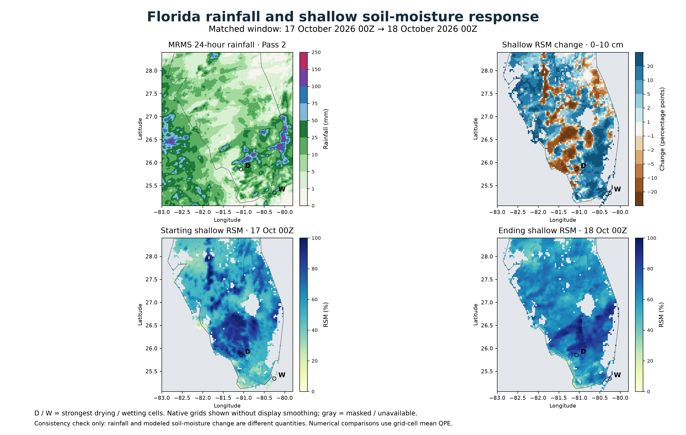

# H7 Florida follow-up: rainfall and shallow RSM

## Result

The matched rainfall comparison supports rainfall-driven wetting gradients as a major contributor to the 24-hour shallow RSM pattern. Strong drying pockets also depend on their very wet starting states. This is a single-case consistency check, not independent validation of SPoRT soil moisture or attribution of every cell's water balance.

Window: **17 October 2026 00Z to 18 October 2026 00Z** (8 PM EDT October 16 to 8 PM EDT October 17). Thus it includes October 17 daytime convection but excludes activity after 8 PM EDT that evening.



## Extreme-cell checks

Rainfall below is MRMS MultiSensor QPE 24H Pass 2 averaged onto each native SPoRT grid cell. Nearest MRMS samples differ slightly because rainfall varies within the larger soil-moisture cells.

| Diagnostic | Strongest drying | Strongest wetting |
|---|---:|---:|
| Latitude / longitude | 25.855 N, 81.065 W | 25.345 N, 80.255 W |
| Starting RSM | 98.564% | 29.312% |
| Ending RSM | 61.842% | 81.694% |
| 24-hour change | −36.722 pp | +52.382 pp |
| MRMS cell-mean rainfall | 1.844 mm | 41.702 mm |
| Nearest MRMS rainfall | 0.900 mm | 43.000 mm |
| 3 × 3 neighborhood median rainfall | 7.856 mm | 27.846 mm |
| 3 × 3 neighborhood median RSM change | −20.713 pp | +44.770 pp |
| Previous day's RSM change (16–17 Oct 00Z) | +56.356 pp | −1.178 pp |

The wetting extreme is embedded in a wider wetting neighborhood, with appreciable rainfall in the same area. The drying extreme began near saturation after a large modeled increase during the preceding day. Its subsequent decline with much less rainfall is consistent with loss/redistribution of shallow soil water; drainage and evapotranspiration components were not measured here, so the precise mechanism and magnitude are not verified.

## Statewide relationship

Florida polygon cell-center mask; 13,828 jointly valid cells with at least 99% valid MRMS coverage after grid averaging. Values are unweighted native-cell summaries, not area-weighted percentages or independent samples.

| Cell-mean 24-hour rainfall | Cells | Median RSM change | Fraction wetting by >1 pp |
|---|---:|---:|---:|
| <1 mm | 6,920 | −2.35 pp | 0.09% |
| 1–5 mm | 2,674 | +1.08 pp | 51.2% |
| 5–10 mm | 2,051 | +9.68 pp | 72.5% |
| 10–25 mm | 1,512 | +14.95 pp | 78.4% |
| 25–50 mm | 495 | +20.11 pp | 94.1% |
| ≥50 mm | 176 | +20.43 pp | 98.3% |

Rainfall/change Pearson correlation is 0.544 statewide and 0.441 for Florida cells south of 28 N. These are descriptive spatial relationships with no independence assumption or significance claim. Initial moisture, soil properties, rainfall timing, drainage, evapotranspiration and forcing differences can prevent a one-to-one relationship. The change map describes modeled response, not rainfall accumulation itself.

## Provenance and handling

- The 16, 17 and 18 October shallow TIFFs were downloaded again. All three SHA-256 hashes matched the earlier review snapshot. This rules out an intervening binary revision between these two checks; it does not establish that earlier revisions never affected the source fields.
- The MRMS GRIB identifies `MultiSensor_QPE_24H_Pass2`, units mm, reference/valid time 18 October 2026 00Z and zero forecast seconds. A 24-hour interval is inferred from the named accumulation product ending at its valid time; the GRIB uses product template 0 rather than an explicit statistical interval template.
- NOAA's current operational product table identifies a 24-hour accumulation with roughly one-hour publication latency. The GDAL local-table comment still says two hours; that stale decoder description was not used to shift the valid period. The downloaded object's Last-Modified was 00:58:02Z.
- Negative MRMS missing/coverage flags were masked, not changed to zero rainfall. QPE was overlap-averaged onto the native soil grid, with valid coverage checked separately. Source-grid CRS definitions were honored. The coastline polygon is the existing dashboard reference and is not a precise land/water mask.
- The 4000 × 2538 diagnostic displays native raster cells without smoothing so localized gradients remain visible. It uses geographic coordinates for direct regional comparison; the previously reviewed dashboard maps retain EPSG:3857 bilinear rendering.
- Source URLs, hashes, raw GRIB metadata, summary statistics and neighborhood diagnostics are in `florida_check.json`. Exact input binaries are not committed. If provider files change, a rerun must be treated as a new revision and compared with this evidence.

NOAA product definition: https://www.nssl.noaa.gov/projects/mrms/operational/tables.php

NOAA latency change history: https://inside.nssl.noaa.gov/mrms/past-code-updates/

## Recommendation

Continue H7 development with the 24-hour shallow change and native 7-day deep change. This case no longer provides a specific reason to suppress the large Florida changes. Preserve the signed values and show absolute RSM alongside change when interpreting drying from a very wet starting state. Retain source-revision tracking and expand case checks during ingest qualification before operational activation.

Reproduce from repo root:

```sh
python tools/fetch_h7_florida.py
python tools/check_h7_florida.py --cache /tmp/h7-florida
```

Dependencies: requests, numpy, rasterio, matplotlib. Downloads use exact timestamps, not latest aliases. Production publishing and schedules remain unchanged.
