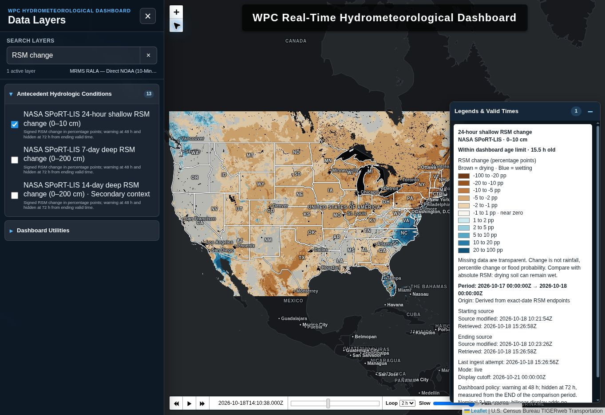

# H7 production rollout — 18 October 2026

Andrew approved production activation, publishing and scheduling. PR #15 merged as `249fd2f7c051f4697b73d45ae5c599ea7d534b02`.

## Publication and restore verification

Workflow run [39140450660](https://github.com/andreworrison-cloud/wpc-hydro-dashboard/actions/runs/39140450660) completed successfully twice:
- Initial job 117713630992 published the 18 October 00Z generation.
- Second job 117714034130 restored numeric artifact 12141556879 and verified all four source versions, then returned H7 state `unchanged`.
- Accepted generation: `20261018-0cb23e8e59c4ad57c961-sport-change-v1`.
- Second successful attempt: 2026-10-18T15:28:26.742482Z.
- Durable second publication commit: `ded1f719ea8d102042ecdeea17e4c0b21d7bd356` on `data/sport-lis`.
- Production workflow qualification passed 58 Python tests across all suites/publishers and 64 Node display tests.

Map data live under `public/change`. Separate source-modification, retrieval, comparison-period and ingest-attempt timestamps remain intact. Warning is at 48 h and hiding at 72 h from ending valid time. The 14-day layer is labeled secondary context.

## Scheduling

H7 is included in the established `fetch_sport.yml` workflow dispatched by cron-job.org job 8666661 at 01:15, 07:15, 13:15 and 19:15 UTC. No new job or competing GitHub cron was introduced.

Existing successful dispatches on October 18:
- 01:15:38Z — run 39085833357
- 07:15:39Z — run 39106999091
- 13:15:41Z — run 39130766342

The cron console required a fresh login in this browser; no console settings were altered. Successful GitHub workflow_dispatch history independently confirms the established schedule was operating before H7 activation.

## Live browser verification

The live Pages deployment succeeded. Browser interaction verified:
- All three H7 controls appear under Antecedent Hydrologic Conditions (13 choices; 154 total dashboard layer registrations).
- Exact periods: shallow 17–18 October, deep 7-day 11–18 October, deep 14-day 4–18 October; all endpoints 00Z.
- Correct derived/native provenance, percentage-point legends, valid-age display and cutoff.
- Exclusive selection switches among the three H7 layers.
- Native PNG dimensions 4000 × 2538 confirmed in the rendered browser.
- State-border and coastal alignment visually checked with WPC Dark Reference, Esri Light Gray and Esri World Imagery, at two zoom levels.
- Opacity slider minimum produced image opacity 0.1 and was restored to maximum.
- These are checks of three representative backgrounds, not every listed basemap.

The initial local-browser connection limitation is resolved by these live production checks. The numeric archive restore has been exercised across two separate runner executions; multi-day retention will accrue as scheduled runs continue.
