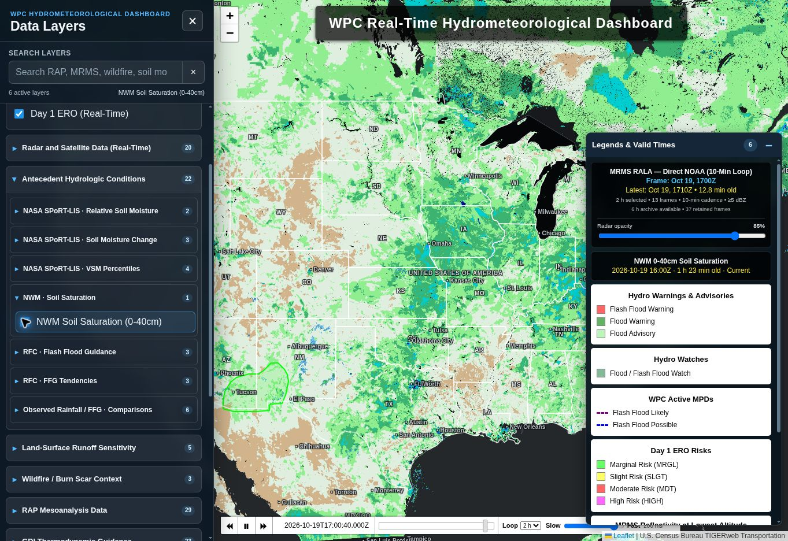

# Production verification — 2026-10-19

PR #28 merged. NWM run 39293368706 succeeded, including source validation and publishing. Published analysis valid 16Z; model initialization 13Z; retrieved 17:21:56Z. Pages run 39293486777 succeeded. Live browser confirmed new script version and `2026-10-19 16:00Z · 1 h 23 min old · Current`, with raster and state borders visible.

Existing cron-job.org QPE hourly dispatcher now calls the independent reusable NWM job; the first post-change hourly dispatch remains to be observed. Native GitHub NWM cron removed.

FFG run 39288958430 (16:50Z workflow_dispatch) succeeded. Live controls verified 6-, 12-, and 24-hour tendencies with correct 16Z endpoint, paired RFC reference cycles, qualified wetting/drying legend, and visible state borders.

